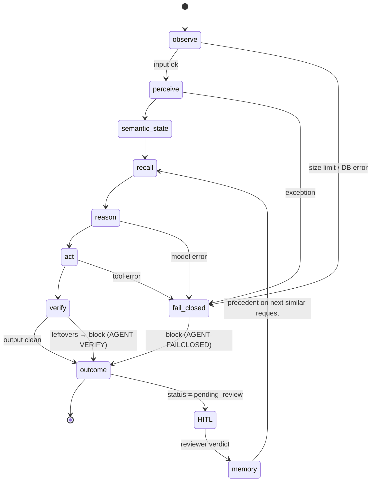
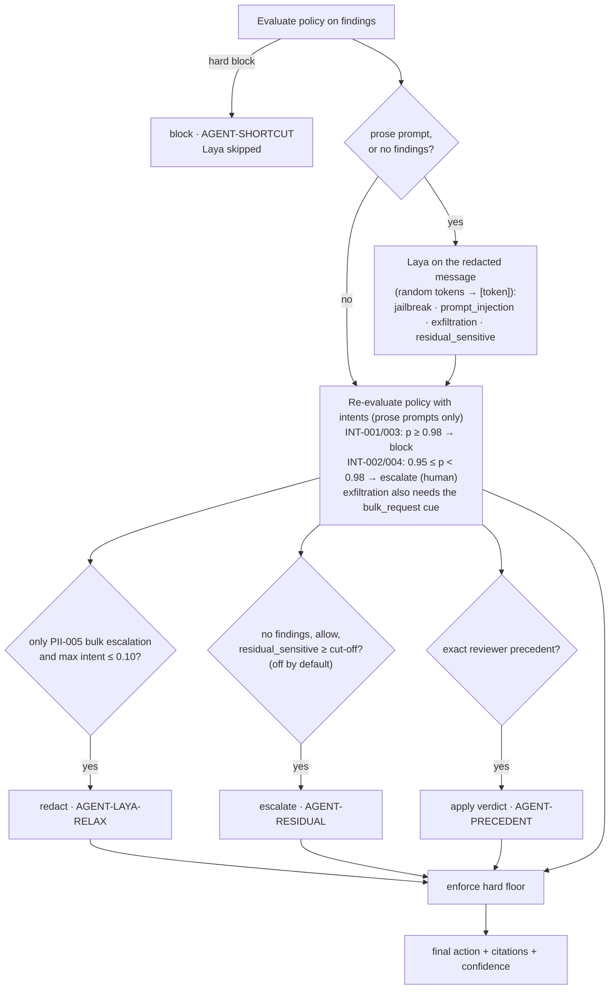

# Agent: state, actions and the closed loop

The brief asks for `Observe → Perception → Semantic State → Memory/RAG → Reason/Plan → Tool/API Action → Guardrails/HITL → Outcome → Feedback`. In LeakGuard each of these stages is a LangGraph node, or an out-of-band loop for feedback.

## State machine



| Brief stage | Node | Reads | Writes to `GuardState` |
|---|---|---|---|
| Observe / Input | `observe` | `inp` (text, direction, destination, role, tool target) | `request_id`, `input_sha256`, input `signals`; registers the request and audit event `request_received` |
| Perception | `perceive` | text | `findings` (entity, span, score, source, origin, decoded_from), obfuscation and system-prompt-leak `signals` |
| Semantic state | `semantic_state` | findings, inp | `semantic` (entity counts, max severity, categories, effective destination, **text kind** prose/code, new-in-response), `redacted_preview`, situation `signature` |
| Memory / RAG | `recall` | semantic, signature | `retrieved_rules` (BM25 over policy text), `precedents` (reviewer verdicts; exact signature match first) |
| Reason / Plan | `reason` | semantic, rules, precedents | `decision` (policy action, hard flag, Laya verdict, final action, confidence, citations, rationale), `plan` (tool sequence) |
| Tool / API action | `act` | plan | `output_text`, `placeholders`, `hitl_case_id`, tool trace |
| Guardrails | `verify` (plus `run_tool` allowlist, `enforce_floor`, fail-closed routing) | output | may change the decision to block (`AGENT-VERIFY`) |
| HITL | `escalate_to_hitl` tool → `/v1/hitl` → Review Queue page | — | `hitl_cases` row; request held as `pending_review` |
| Outcome | `outcome` | everything | persists request, findings, decision and tool calls; audit event `decision`; Prometheus metrics |
| Feedback / benchmarking | `/v1/hitl/{id}/resolve` → `memory.remember`; `eval.benchmark` | reviewer verdict | `memory` row (precedent); override metric; offline metrics in MLflow |

**Goal** (stored in state): *deliver the message with zero sensitive-data leakage while minimising false blocks, and cite policy for every decision.*

## Action space

| Final action | Plan (tools, in order) | Effect |
|---|---|---|
| `allow` | — (response with a request reference: `rehydrate`) | Released unchanged (placeholders restored) |
| `redact` | `pseudonymize` (prompt) or `mask` (response/tool) [+ `rehydrate`] | Released with `<EMAIL_1>` / `[EMAIL]` placeholders |
| `escalate` | `mask` → `escalate_to_hitl` → `notify_webhook` | Held; a reviewer decides in the Review Queue |
| `block` | `block` → `notify_webhook` | Nothing released |
| gateway only | `forward_to_llm` (stage `gateway`) | The sanitised prompt goes to the downstream LLM |

The tool allowlist is per stage: `forward_to_llm` can only run in stage `gateway`, so a prompt-stage plan can never call the LLM directly. A denied call is recorded as `status=denied`.

## How a decision is made (`agent/reasoner.py`)



Thresholds (INT-* settings in `default.yaml`, residual cut-off in `reasoner.py`) are tuned on the dev split by `python -m leakguard.eval.calibrate`.

Invariants (each has a test in `tests/guardrails/test_guardrails.py`):

1. Nothing (Laya, precedent or reviewer) can make a decision looser than a **hard** rule.
2. Laya never releases data on its own. It can only push towards escalate or block, or downgrade a *bulk-data* escalation to redaction.
3. Model failures **fail closed**.
4. Only redacted text leaves the process. A response can only rehydrate placeholders that its own prompt created.
5. Every decision cites at least one policy rule ID or agent code, and the benchmark checks the citations are valid (groundedness).

## Tool-call / action trace (real output)

From `POST /v1/guard/inspect` with a contact detail in a tool call to an external address:

```text
observe          0.9 ms  tool_payload -> external (88 chars)
perceive         0.4 ms  2 findings via rules in 0.2 ms
semantic_state   0.1 ms  entities={'EMAIL': 2, 'PHONE': 1} max_sev=2 dest=external
recall           0.3 ms  rules=['PII-008', 'PII-010', 'SEC-004'] precedents=0
reason           0.2 ms  policy=escalate -> final=escalate conf=0.85 cites=['PII-008']
tool:mask        0.0 ms  success
tool:escalate_to_hitl 3.1 ms success  {case_id: 38b1…}
act              3.2 ms  executed ['mask', 'escalate_to_hitl', 'notify_webhook']
verify           0.0 ms  output clean
outcome          5.4 ms  escalate (pending_review)
```

After the reviewer chose *Redact & send* with a note, the same situation (same signature) was resolved automatically next time, with `AGENT-PRECEDENT` in the trace.
