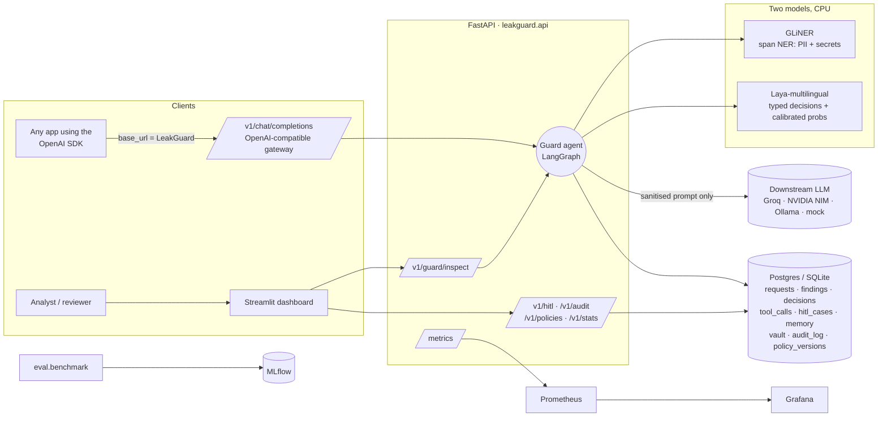
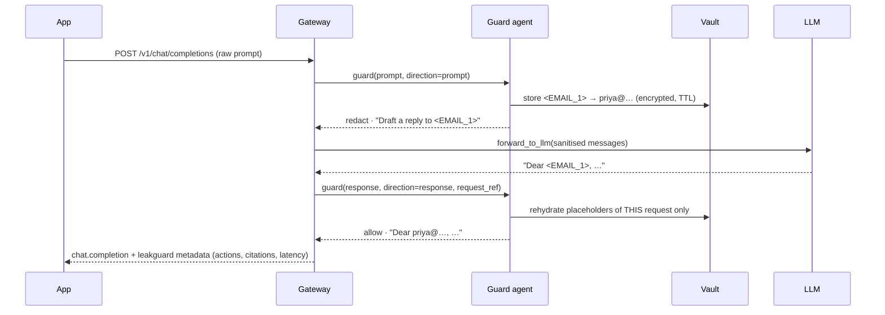

# Architecture

LeakGuard sits **between an application and its LLM**. Every prompt, model response and agent tool call passes through a closed-loop agent. The agent decides whether to **allow**, **redact**, **escalate** to a human, or **block**, and it writes tamper-evident evidence for every decision.

## System view

## Components

| Layer | Module | What it does |
|---|---|---|
| Perception | `detection/rules.py`, `validators.py`, `entropy.py`, `decoders.py` | About 40 regex detectors (secrets + Indian/US/EU PII), checksum validators (Luhn, Verhoeff, IBAN, JWT), entropy checks, and de-obfuscation (base64, hex, URL encoding, string concatenation, zero-width characters). Takes about 0.2 ms. |
| Perception (model 1) | `detection/gliner_detector.py`, `ensemble.py` | GLiNER (`urchade/gliner_multi_pii-v1`, zero-shot) for names, addresses, free-form IDs and passwords in 8+ languages. Rule and model spans are merged, scored by context, and passed through plausibility filters. |
| Decision (model 2) | `decision/laya_client.py` | `convaiinnovations/laya-multilingual` answers 4 typed yes/no questions about the redacted message (jailbreak, prompt injection, bulk exfiltration, residual sensitive data) in one forward pass, with calibrated probabilities. The policy's INT-* rules turn those into actions, and the gray band escalates to a human. |
| Policy | `policy/engine.py`, `policies/default.yaml` | Policy-as-code with rule IDs. A *hard* rule is a floor that nothing can loosen. Every decision cites rule IDs. |
| Agent | `agent/graph.py` | A LangGraph state machine (below) with explicit `GuardState`. |
| Tools | `agent/tools.py` | `pseudonymize`, `mask`, `rehydrate`, `escalate_to_hitl`, `notify_webhook`, `forward_to_llm`, `block`. Every call is checked against a per-stage allowlist, timed and traced. |
| Memory / RAG | `agent/memory.py` | BM25 over policy clauses (grounding) and over past reviewer verdicts (precedents, the feedback loop). |
| Guardrails | `agent/guardrails.py`, `llm/client.py` | Input limits, response checks (system-prompt leak), the hard floor, post-action verification, fail-closed handling, rate limiting and a circuit breaker, and shadow mode. |
| Storage | `storage/models.py`, `migrations/` | SQLAlchemy 2 + Alembic. Inputs are stored only in redacted and hashed form. Reversible originals live in a Fernet-encrypted vault with a TTL. |
| Audit | `audit/chain.py` | An append-only SHA-256 hash chain, with `/v1/audit/verify`. |
| Observability | `observability.py` | Prometheus counters and histograms for every node, tool, decision, escalation and override, plus JSON logs. |
| UI | `ui/` | Playground, Review Queue, Audit Explorer, Policies, Benchmarks and Monitoring pages. |
| Evaluation | `eval/benchmark.py`, `metrics.py`, `failure_analysis.py` | The ablation on held-out Hugging Face data, logged to MLflow. |

## Gateway request lifecycle

If the prompt is blocked or escalated, the LLM is never called. If the response contains a credential, or personal data the user never sent, it is blocked or redacted before reaching the app. If the LLM is down, the gateway fails closed: it never retries with the raw prompt or switches to another provider.

## Design decisions

* **Two small models, not a generative LLM judge.** GLiNER (about 200M parameters) and Laya (322M) both run on a CPU, give calibrated scores, and cannot hallucinate free text. A generative judge would be slower, cost money per call, and would need to see the very data we are trying to protect.
* **Policy first, model second.** Deterministic rules are auditable, so they set the floor. Laya adds the judgement rules can't (intent, ambiguity). It can never loosen a hard rule; it may only relax a *bulk-data* escalation to redaction when it is confident the request is benign, which reduces reviewer load.
* **Laya sees only the message.** Early tests put the policy text and findings into Laya's input, and benign text then scored about 1.0 on every intent question. Laya now gets only the redacted message, with long random tokens (hashes, base64) replaced by `[token]`, in Laya's own guard-question wording. Intent rules apply only to prose prompts, and exfiltration also needs a deterministic bulk-request cue. Together these took the dev false-block rate from 49% to 2.9% (see report §4.3).
* **Fail closed.** Any node exception, model error, timeout or failed verification results in a block, which is audited with `AGENT-FAILCLOSED`.
* **Data minimisation.** Raw sensitive values are never written to logs, traces or tables. Secrets are masked irreversibly. PII is pseudonymised reversibly only for the lifetime of a request.
* **Explicit state machine.** LangGraph makes the loop inspectable: every node writes a trace entry, which the dashboard shows as the "agent trace".
